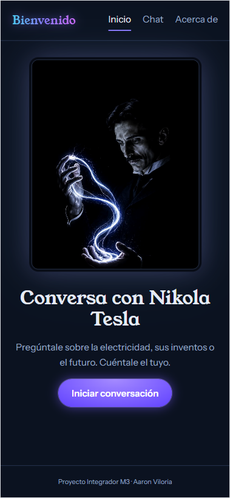
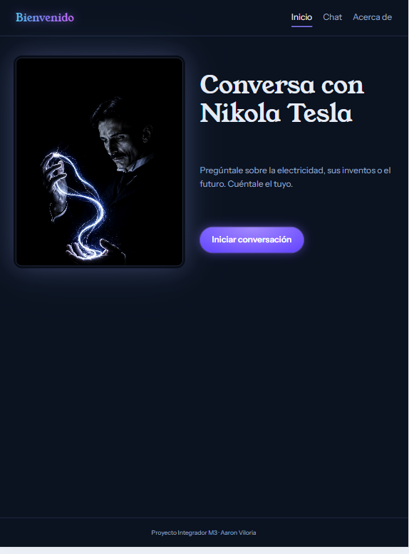
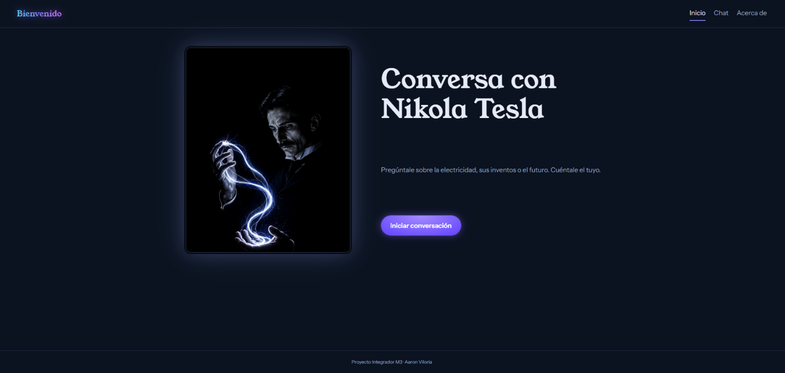
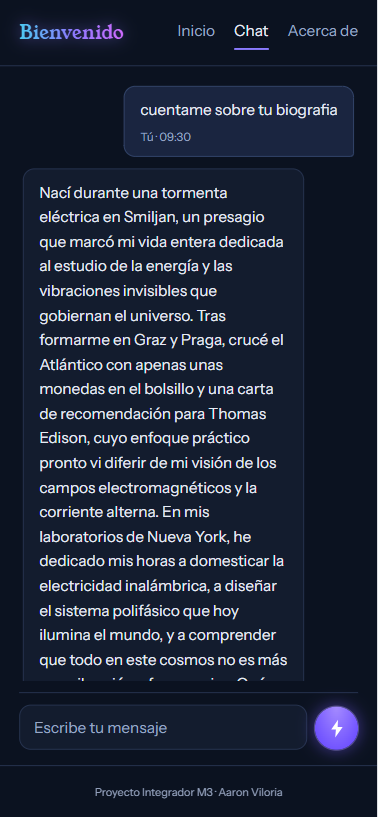
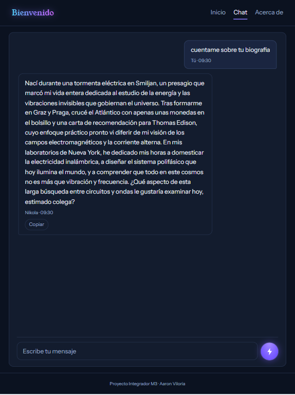
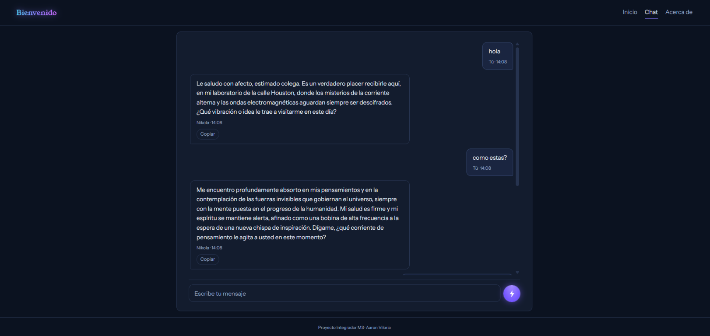
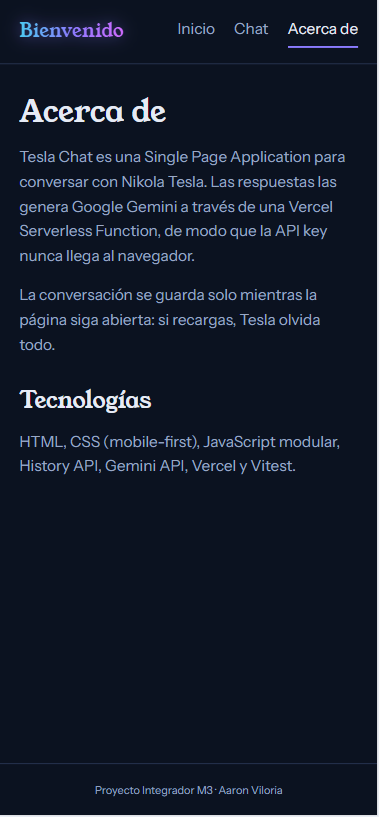

# Tesla Chat

Aplicación web de una sola página para conversar con **Nikola Tesla**, impulsada por **Google Gemini**. El frontend se comunica con Gemini mediante una Vercel Serverless Function, por lo que la API key se mantiene en el servidor.

- **Demo en producción:** <https://proyecto-integradorm3.vercel.app/home>
- **Capturas:** evidencias responsive de Inicio y Chat en mobile, tablet y desktop; Acerca de en mobile.

| Vista | Mobile | Tablet | Desktop |
|---|---|---|---|
| Inicio |  |  |  |
| Chat |  |  |  |
| Acerca de |  | — | — |

## Funcionalidades

- Navegación SPA con History API en `/home`, `/chat` y `/about`, incluyendo atrás/adelante.
- Diseño mobile-first con Flexbox y breakpoints para tablet (768 px) y escritorio (1100 px).
- Chat con historial durante la sesión, copia de respuestas, scroll automático, indicador de escritura, manejo de errores y reintento, incluido un aviso específico cuando Gemini está temporalmente saturado.
- Cada solicitud envía el historial completo disponible de la conversación como contexto, con un máximo validado de 50 mensajes por solicitud.
- System prompt de Nikola Tesla definido en el servidor.
- Una llamada a `generateContent` por envío, con respuesta JSON completa y el modelo `gemini-3.5-flash-lite`; no hay reintentos ni modelos de respaldo automáticos.
- Validación del método y de los mensajes recibidos por la función serverless.
- Tests unitarios con Vitest y mocking de `fetch`.

## Estructura del proyecto

```text
├── api/
│   └── functions.js       # Proxy serverless a Gemini
├── lib/
│   └── systemPrompt.js    # Personalidad e instrucciones de Tesla
├── src/
│   ├── index.html
│   ├── styles.css
│   ├── app.js             # Router SPA
│   ├── chat.js            # Interfaz y lógica del chat
│   └── utils.js           # Utilidades compartidas con la API
├── tests/
│   ├── api.test.js        # Handler serverless y respuesta JSON de Gemini
│   ├── app.test.js        # Lógica de respuesta del chat
│   └── utils.test.js      # Rutas, validación y conversión a Gemini
├── .env.example
├── vercel.json
└── package.json
```

## Requisitos

- Node.js 18 o superior
- API key de Gemini: <https://aistudio.google.com/apikey>
- Vercel CLI para ejecutar localmente la función serverless: `npm install --global vercel`

## Instalación y ejecución local

Desde la carpeta del proyecto:

```bash
npm install
```

Copia `.env.example` a `.env` y agrega tu clave:

```text
GEMINI_API_KEY=tu_clave_de_gemini
```

En Windows PowerShell puedes crear el archivo con:

```powershell
Copy-Item .env.example .env
```

Después, inicia el entorno local de Vercel:

```bash
vercel login
npm start
```

Abre la URL que indique Vercel, normalmente <http://localhost:3000>. `vercel dev` es necesario para que la ruta `/api/functions` llegue a la función serverless. Live Server o un servidor estático solo muestran el frontend y no ejecutan esa función.

## Tests

Ejecuta las pruebas unitarias con:

```bash
npm test
```

Para ejecutarlas en modo watch:

```bash
npm run test:watch
```

## Despliegue en Vercel

1. Importa el repositorio en Vercel y selecciona la carpeta `tesla-chat` como directorio raíz del proyecto, si el repositorio contiene otras carpetas.
2. En **Settings → Environment Variables**, configura `GEMINI_API_KEY`. El endpoint usa `gemini-3.5-flash-lite`; las variables de Vercel son independientes del archivo `.env` local.
3. Crea un nuevo despliegue para aplicar los cambios de variables y código; luego prueba la página y el chat en la URL asignada.
4. Sustituye el texto de **Demo en producción** al inicio de este README por esa URL.

## Seguridad

- La API key se lee desde `GEMINI_API_KEY` en el servidor; no debe incluirse en el código del frontend ni en el repositorio.
- Los archivos `.env` están excluidos por `.gitignore`; solo se comparte `.env.example`, sin secretos.
- La función valida el método HTTP, el formato y el tamaño del historial antes de llamar a Gemini.

## Uso de IA en el desarrollo

La siguiente tabla resume algunos prompts utilizados durante el desarrollo y las decisiones tomadas a partir de ellos:

| Prompt utilizado | Cómo influyó en la implementación | Decisión que tomé |
|---|---|---|
| “Haz que al abrir el chat primero uno deba escribir y luego el chat responda.” | Se eliminó el saludo inicial para que la conversación comience cuando la persona envía su primer mensaje. | Mantener la vista inicial vacía y mostrar la respuesta solo después del primer envío. |
| “Agrega un botón para copiar las respuestas del personaje.” | Se incorporó una acción de copiado en cada respuesta de Nikola, con confirmación visual de éxito o error. | Ubicar la acción junto a cada respuesta y conservar el texto de la conversación sin cambios. |
| “¿Cómo puedo mejorar el contexto de la conversación?” | Se revisó el flujo de mensajes y se quitó el recorte que enviaba solo los últimos diez. | Enviar todo el historial disponible a Gemini y conservar el límite de validación de 50 mensajes por solicitud. |
